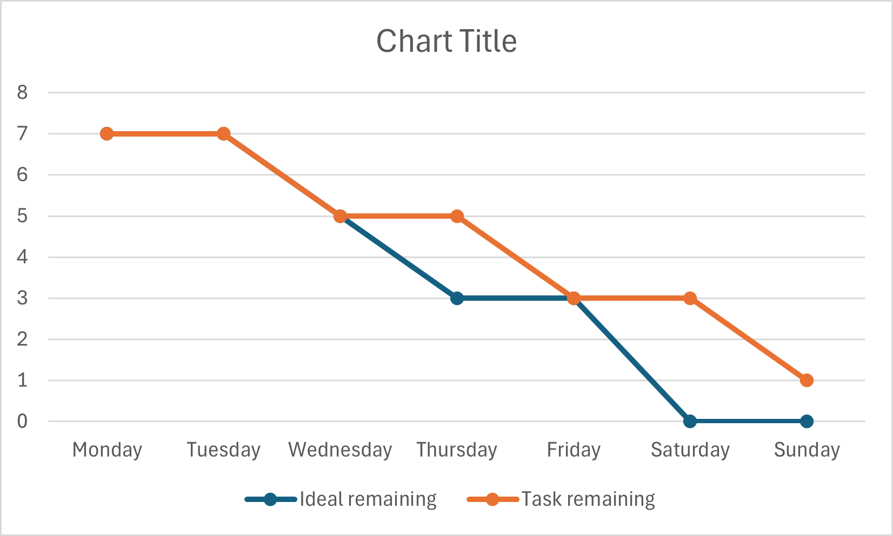

# Sprint 2 - Burndown Chart

## Daily Progress Analysis
* **Monday & Tuesday:** Focused on planning and carry-over tasks from Sprint 1. The line remained flat as we were setting up the new requirements.
* **Wednesday:** Started implementing the core logic for the Assessment Tools.
* **Thursday:** Continued steady progress on the MVC architecture and Questions components.
* **Saturday:** Completed some features for the Free-text response and MCQ logic.
* **Sunday:** Finalized the sprint. Finished the day with **1 task remaining** (carried over to Sprint 3).
